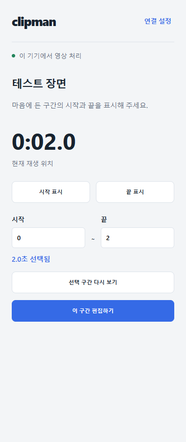
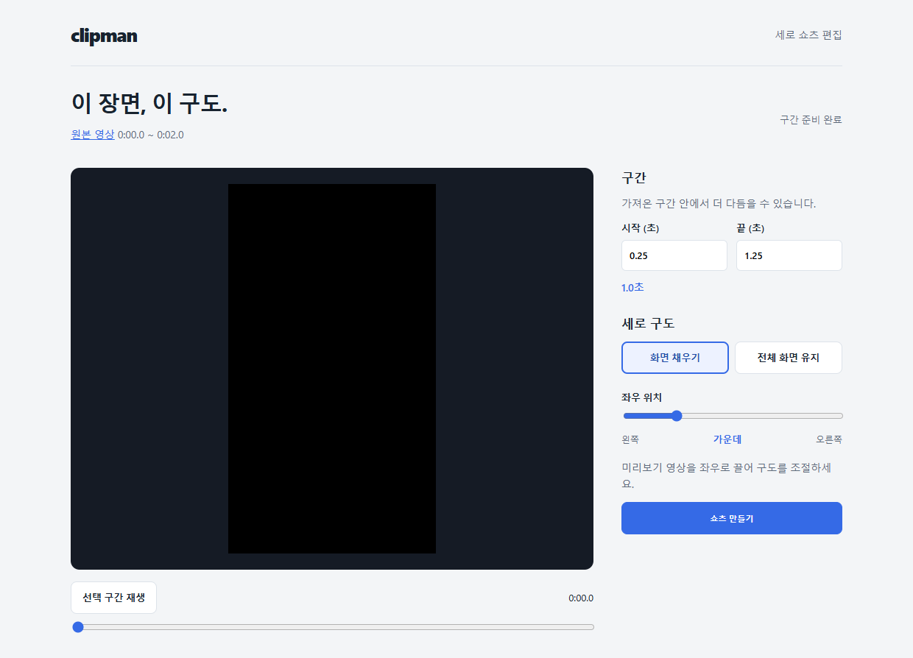
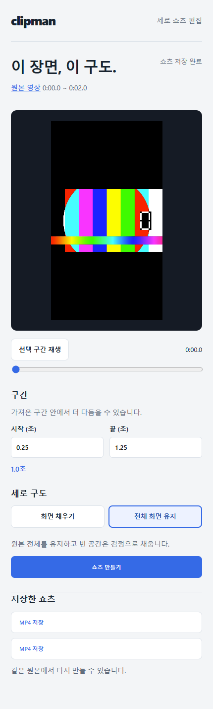

# 2026-10-12 개발 및 릴리즈 확인 기록

이 문서는 이번 대화에서 정한 범위, 구현, 검증, 릴리즈 검토와 다음 작업을 함께 읽기 위한 기록임. 상세 진본은 아래 연결 문서와 코드임.

## 사용자 요청과 결정

1. 로드맵에 따라 개발 착수를 요청함.
2. Chrome용 확장 개발임을 확인하고 계속 진행하도록 지시함. 기존 승인 형태는 Chrome 확장 + 로컬 처리 프로그램임.
3. 스토어 등록 필요 여부와 본인 전용 사용 가능성, 이번 플러그인의 릴리즈 경로 확인을 필수로 요청함.
4. 현재까지의 내용을 모두 GitHub에 기록하도록 지시함.

팬덤/한국어 특화와 전체 다운로드 필수 선행은 현재 방향이 아님. 모바일에서 발췌, 편집과 저장까지 완료한다는 후속 목표는 유지함. 개인용 로컬 설치는 이번 검토의 추천이며 사용자에게 최종 릴리즈 경로를 확정받은 것으로 기록하지 않음.

## 구현과 변경 이력

- `f97bdc3`: 선택 영상 ID/URL 일치, 원본 선택 시각과 확보 파일의 로컬 시각, 구간 다운로드 명령, 작업 관리와 원본 보존 기반을 구현함. 긴 영상의 소수점 시각 손실을 수정함.
- `7d6de13`: MV3 content script와 서비스 워커, Svelte 패널/편집 탭, FastAPI와 실제 영상 처리 서비스, 실행기 및 개인 패키지를 연결함.
- 이번 기록 보완: 세션 기록, 화면 및 개인 ZIP의 GitHub 보관, ZIP의 제3자 런타임 라이선스 고지와 최신 핸드오프를 추가함. 저장소 브랜치는 `codex/capture-foundation-20261012`, 검토는 [Draft PR #2](https://github.com/blazethrottle/clipman/pull/2)임. main 병합은 수행하지 않음.

사용 흐름은 YouTube의 시작/끝 표시 -> 선택 구간 확보 -> 로컬 시각 트림 및 9:16 크롭/PAD -> 음성을 유지한 MP4 저장 -> 같은 원본의 재편집임. 무거운 처리는 로컬 프로그램이 수행함.

## 확인한 검증

| 항목 | 결과와 한계 |
|---|---|
| 기본 pytest | 178 passed. API 출처/키/요청/경로, 작업 경합과 키 보존 포함 |
| 실물 통합 | 9 passed, skipped 0. 실제 ffmpeg/yt-dlp와 합성 HTTP 영상, API 확보/출력/재편집, 좌우 장면 확인 |
| 확장 로직 | Node 5 passed. 연결 주소, 허용 API, 마커, 네이티브 크롭 좌표 및 메시지 경계 |
| 실제 MV3 브라우저 | 1 시나리오 통과. 독립 Chromium 프로필, 합성 YouTube 페이지, 실제 MP4 재생/출력/다운로드와 설정 복원 |
| 개인 ZIP | 압축 및 모든 파일 대조, 해시, 압축해제본의 실제 확장 로드 검사 |
| 신규 실행기 | 9000 점유 시 다른 실제 포트의 연결 안내를 확인함 |
| 실제 YouTube | 단일 영상 jNQXAC9IVRw의 0~2초 확보, 1080x1920 1초 음성 MP4 변환 확인. 범용 영상 품질로 일반화하지 않음 |

[검증 상세](verification/2026-10-12-chrome-first-connection.md), [패키지 파일 및 해시](verification/2026-10-12-personal-package.json)

독립 리뷰 1명이 연결 키의 storage.local 노출과 POSIX 잔여 자식 종료 경계를 지적함. TRUSTED_CONTEXTS 초기화를 먼저 완료하도록 수정하고 실제 content isolated world의 키 읽기 거부를 확인함. POSIX 부모 종료 후에도 소유 그룹에 KILL을 보내도록 보완함. Windows 실제 트리와 POSIX 대역 검사는 통과했으며 Mac 실기기 검사로 확대하지 않음.

미저장 설정의 새로고침 복원과 편집 탭 왕복 후 마커 소실도 브라우저 검사 실패를 확인한 뒤 수정함. 기존 테스트 영상 BaW_jenozKc의 unavailable 응답과 yt-dlp JavaScript 런타임 미설정 경고는 성공 근거와 분리해 기록함.

## 현재 화면

아래 화면은 소유한 합성 시험 영상으로 생성함. 실제 사용자 영상이나 연결 키를 포함하지 않음.

### 구간 선택 패널

### 세로 편집 탭

### 좁은 화면의 편집

## 개인 사용과 릴리즈

스토어 등록 없이 개발자 모드에서 확장 폴더를 로드해 본인만 사용하는 경로가 있음. 현재 추천은 이 방식으로 실제 사용성을 먼저 인수하는 것임. Private는 지정 계정, Unlisted는 링크를 아는 사람, Public은 일반 검색/설치 대상이며 스토어의 세 설정 모두 정책 심사가 필요함. 등록비 금액과 심사 승인은 추정하지 않음.

구체 설치 순서, Windows/macOS의 CRX 외부 설치 제약, 스토어 정책과 출처는 [릴리즈 안내](RELEASE.md)에 있음. 이번에는 스토어 등록/심사/게시와 GitHub Release 게시를 수행하지 않음.

[개인 설치용 확장 ZIP](artifacts/clipman-extension-0.2.0-personal.zip)은 확장만 포함함. 압축을 풀어 manifest.json이 있는 폴더를 로드함. 이 PC에서는 기존 작업 폴더의 start.cmd와 로컬 처리 환경을 함께 사용함. 다른 PC에 이 ZIP만 복사하면 영상 처리 프로그램까지 설치되는 것은 아님. 패키지에는 Svelte/esm-env/clsx의 제3자 라이선스 고지를 포함함.

## 남은 작업

- 본인 Chrome 프로필에서 실제 사이드 패널과 실제 YouTube 시청부터 MP4 저장까지 인수함. 자동 검사는 패널 페이지를 확장 탭으로 열었음.
- 여러 영상의 실제 장면 시각, 고화질, 제한/로그인/쿠키, JavaScript 런타임, 전송량 및 대기를 확인함.
- Mac 실행기/바이너리와 프로세스 트리, 일반 사용자용 로컬 설치 및 업데이트를 검증함.
- 스토어 경로를 선택하면 다운로드 기능의 적용 정책, 심사자가 실행할 설치 안내와 실제 스토어 확장 ID 연결을 검증함.
- 탭 녹화 대안 및 모바일 기기 내 발췌/편집/저장 목표를 후속으로 유지함.

다음 세션은 [HANDOFF](HANDOFF.md)의 최신 요청을 따르며 완료한 구현을 다시 만들지 않음.
